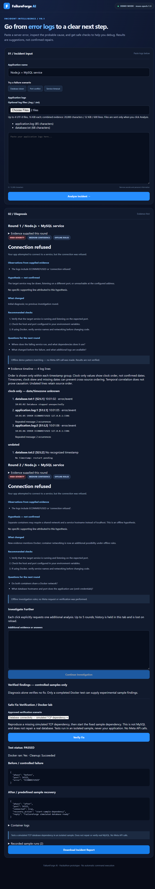

# FailureForge AI

An interactive failure investigation and safe verification prototype for the Meta Global AI Developer Hackathon 2026.

**Workflow:** upload multiple logs → inspect hypotheses → answer targeted questions → revise the investigation → run an approved Docker experiment → download an evidence-backed Markdown report.

## Architecture

React + Vite provides manual logs, three sample incidents, multiple file inputs, chronological investigation rounds, timelines, sample verification, and report download. FastAPI validates bounded requests, redacts obvious credentials, processes evidence and calls Meta Muse Spark 1.3 through the existing backend-only Meta Model API configuration. Demo mode uses deterministic offline rules with zero model calls. History lives in browser memory; no database is required.

Routes: GET /api/health and POST /api/analyze, /api/investigate, /api/verify-fix, /api/report. Vite forwards /api to **127.0.0.1:8001**.

Two fixed Docker fixtures reproduce port conflicts and a missing simulated TCP database dependency. Neither executes AI-generated commands or repairs the user's application.

## Setup — Windows Git Bash

Prerequisites: Python 3.12, Node.js/npm, Docker Desktop with Linux containers for optional verification. Demo mode needs **no API key or environment file**. Do not overwrite existing private configuration. From the repository root:

```bash
cd backend
py -3.12 -m venv .venv
./.venv/Scripts/python.exe -m pip install -r requirements.txt
DEMO_MODE=true ./.venv/Scripts/python.exe -m uvicorn app.main:app --host 127.0.0.1 --port 8001
```

In another Git Bash terminal:

```bash
cd frontend
npm ci
npm run dev
```

Open http://127.0.0.1:5173 and confirm DEMO MODE. For an existing installation skip environment creation and dependency installation. On Linux/macOS use python3 and .venv/bin/python. PowerShell commands and detailed limits: [INVESTIGATION.md](INVESTIGATION.md).

Build the fixtures from the repository root:

```bash
docker build --pull=false -t failureforge-port-conflict:1 backend/docker/port-conflict
docker build --pull=false -t failureforge-database-connectivity:1 backend/docker/database-connectivity
```

Building may download a missing base image; verification never pulls images.

## Demonstration

1. Try Database down, Port conflict and Service timeout; all produce offline diagnoses.
2. Clear manual input. Upload application.log with `10:01:05 ERROR ECONNREFUSED 127.0.0.1:3306` and a repeated error at 10:01:06. Upload database.txt with `10:01:02 Database stopped unexpectedly`.
3. Click Analyze and expand the timeline. Inspect source lines, repeated counts and timestamp caveats.
4. Enter `MySQL runs in Docker and Node runs in another container.` and click Continue Investigation. Earlier diagnoses remain visible. Offline rules add a networking hypothesis; live mode uses Meta to reconsider the evidence.
5. Select an approved scenario and click Verify Fix. Inspect before/after evidence, Docker execution and cleanup status.
6. Download Incident Report before reloading. It includes history, evidence, hypotheses, recommendations, mode/model, recorded sample runs and limitations.

Actual browser capture with synthetic logs, offline diagnosis and real Docker:



## Technical differentiation

FailureForge retains an evolving evidence trail rather than replacing each answer. Targeted questions guide evidence collection, validated quotations connect hypotheses to source lines, timestamp groups avoid inventing global order, and a separate allowlisted Docker layer tests predefined recoveries. Reports distinguish suggestions from experimentally observed sample outcomes.

## Tests and verified status

```bash
cd backend
DEMO_MODE=true RUN_DOCKER_TESTS=1 ./.venv/Scripts/python.exe -m pytest -q
```

```bash
cd frontend
node --test src/api.test.js src/uploads.test.js
npm run build
```

Latest regression: **62 backend tests passed**, including both real Docker tests; **11 frontend tests passed**; production build passed. Browser checks covered all three samples, multiple uploads, two investigation rounds, both Docker scenarios and downloaded report. See [verification record](VERIFICATION.md), including the initial transient Docker timeout.

Provider tests use mocked HTTP responses with the real SDK parser. No live Meta calls were made. Earlier live single-request results were owner-reported; multi-turn live quality remains unverified. Fresh dependency installation on an independent machine was not performed; the installed environment builds and runs.

## Limits and security

Four UTF-8 text files, 16 KiB each; combined evidence 20,000 characters / 32 KiB / 600 lines. Five rounds; follow-up evidence up to 6,000 characters. Plain filenames only; uploaded content is never executed. Redaction is best-effort: review logs and reports before sharing.

Missing dates, timezones and clock skew can prevent ordering. Correlation is not causation. Offline rules do not provide general AI reasoning or guaranteed line attribution. Reports are client-supplied snapshots, not signed audit records. Docker success applies only to a disposable fixture; the database fixture is **not MySQL**. Cold/busy Docker can time out; ensure it is ready and explicitly retry. History is lost on reload. No production authentication or persistent case storage is included; keep the service local.

Only after explicit owner authorization for spending: restart the backend with process DEMO_MODE=false using existing backend-only credentials, Analyze synthetic logs once, then optionally Continue once (up to two paid calls). Restore DEMO_MODE=true and restart afterward. Never place keys in frontend or VITE variables.

See [security](SECURITY.md), [verification isolation](SAFE_FIX_VERIFICATION.md), and [submission summary](SUBMISSION.md).
